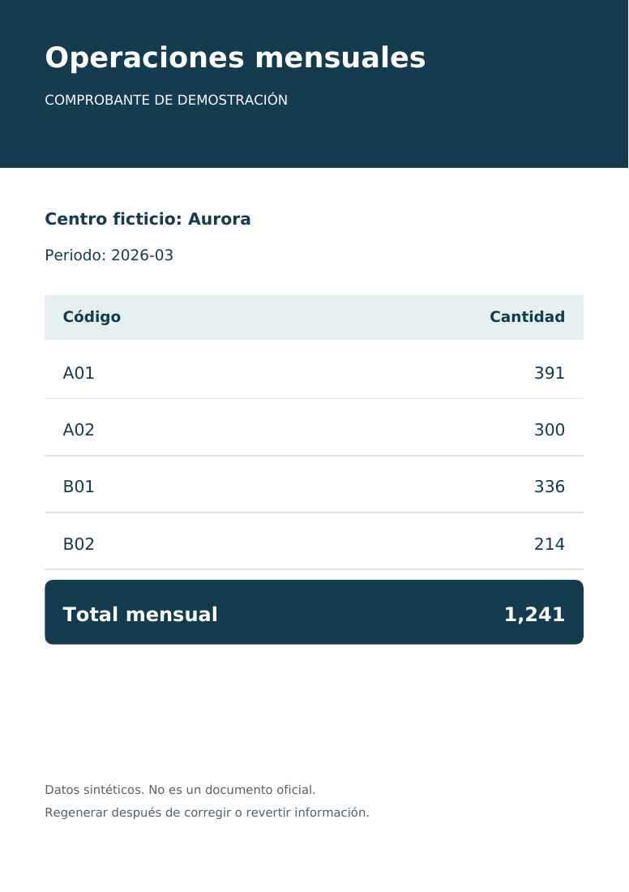

# ETL de operaciones mensuales · FESE-Portfolio

**Python · SQLite · Excel · PDF · Calidad de datos · Auditoría**

[English](README.en.md) · [Arquitectura](docs/ARCHITECTURE.md)

Proyecto ejecutable de portafolio que transforma entregas mensuales CSV/XLSX en un histórico validado, un reporte anual Excel y comprobantes PDF. Demuestra detección de periodos repetidos, revisión previa y correcciones reversibles.

**Los centros, códigos y cifras son ficticios.** Implementación independiente de demostración, sin código ni historial institucional, archivos reales, formatos oficiales, logotipos, listas de correos o configuración de infraestructura.



## Ejecución rápida

Python 3.11 o superior. Funciona en Windows, Linux y macOS; no requiere Excel instalado, Outlook ni servidor de base de datos.

```powershell
git clone https://github.com/gerardomelkart/FESE-Portfolio.git
cd FESE-Portfolio
python -m venv .venv
.\.venv\Scripts\python.exe -m pip install -r requirements.txt
.\.venv\Scripts\python.exe demo.py
.\.venv\Scripts\python.exe -m pytest -q
```

En Linux/macOS utiliza `.venv/bin/python`. Con el entorno activado basta `python demo.py`.

La demo carga enero–marzo de 2026 para Aurora, Boreal y Coral, repite deliberadamente enero de Aurora en marzo para mostrar la alerta y aplica una corrección sintética de +17. Para repetirla utiliza otro directorio: `python demo.py --workdir work/otra-demo`. No borra históricos existentes.

| Archivo en `work/demo/` | Contenido |
| --- | --- |
| `history.sqlite` | 36 registros y cuatro operaciones auditadas |
| `backups/*.sqlite` | Respaldos completos antes de cargas/correcciones |
| `reports/annual-2026.xlsx` | Resumen, gráfica, registros y auditoría |
| `reports/*.pdf` | Nueve comprobantes ficticios por centro y mes |
| `reports/audit.json` | Metadatos, hashes y alertas |

[Excel de ejemplo](docs/annual-2026.xlsx) · [PDF de ejemplo](docs/comprobante-demo-es-v2.pdf)

## Carga y validación

Columnas exactas: `period,center,code,total`, en ese orden. Se acepta CSV o la hoja activa de XLSX sin depender de su nombre. Cada archivo debe contener las 12 combinaciones de centros `Aurora`, `Boreal`, `Coral` y códigos `A01`, `A02`, `B01`, `B02`. Totales enteros entre 0 y 1,000,000,000; las sumas se calculan de los registros validados.

```powershell
python etl.py generate --output examples
python etl.py load examples/2026-01.csv --period 2026-01
python etl.py load examples/2026-01.csv --period 2026-01 --apply
python etl.py report --year 2026
```

Sin `--apply` sólo se revisan cambios de datos; la inicialización puede crear una base vacía y su esquema. Una carga idéntica no duplica registros ni auditorías. Se rechazan periodos inválidos, centros/códigos desconocidos, combinaciones faltantes, duplicados y cifras incorrectas.

Cada distribución completa por centro se compara con **todos sus meses anteriores**, aunque no sean consecutivos. Las coincidencias exactas generan alertas sin rechazar automáticamente datos legítimos.

## Corrección y reversión

Para reemplazar un mes existente se requieren `--correction` y un motivo. Primero debe estar cargado el marzo original en el directorio predeterminado:

```powershell
python etl.py load examples/2026-03-corrected.csv --period 2026-03 --correction --reason "Correccion sintetica" --apply
```

Después de ejecutar `demo.py`, la corrección tiene ID 4:

```powershell
python etl.py --workdir work/demo undo 4
python etl.py --workdir work/demo undo 4 --apply
python etl.py --workdir work/demo report --year 2026
```

Se cambia únicamente el mes seleccionado en una transacción. La bitácora conserva valores anteriores/posteriores y hash SHA-256 del insumo. La reversión se bloquea si hubo cambios posteriores en el periodo y genera una nueva auditoría. Regenera los reportes después de corregir o revertir. Los respaldos sirven para recuperación completa fuera de línea y `undo` para reversión selectiva validada.

## Pruebas y alcance

Nueve pruebas cubren validaciones, equivalencia CSV/XLSX, cargas sin duplicación, repetición de meses no consecutivos, aislamiento de correcciones, reversión, generación reproducible y conciliación del Excel. GitHub Actions está configurado para Python 3.11, 3.12 y 3.13.

Demo local con catálogos ficticios fijos. No envía correos, no incluye autenticación ni interfaz web y no se conecta a sistemas institucionales. Los reportes se generan por separado; la auditoría SQLite no es inalterable. Los datos son agregados mensuales.

No se otorga licencia de reutilización; la visibilidad pública por sí sola no la concede. Las dependencias conservan sus licencias.
