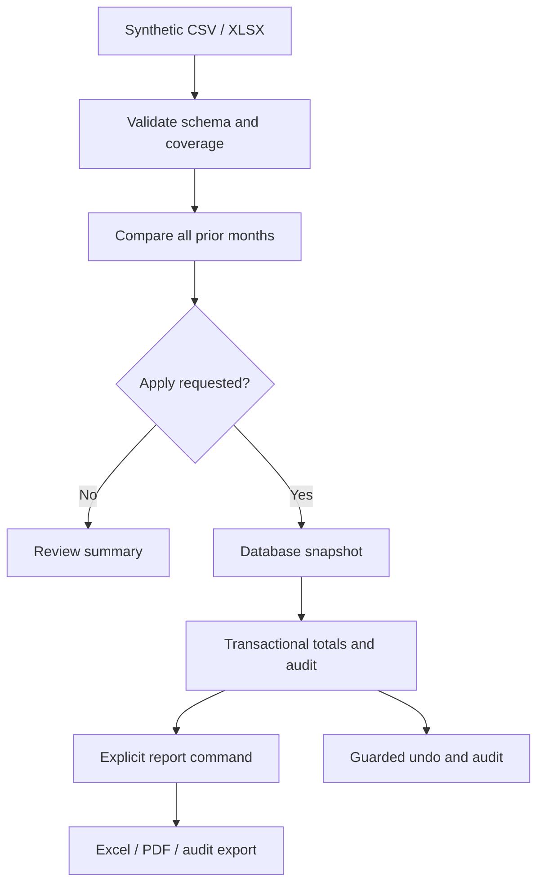

# Architecture / Arquitectura

## Design decisions

- Independent implementation: no institutional code, commits, inputs or configuration. Seeded synthetic generator (`42026`).
- Grain: one row per `(period,center,code)`. Database primary key enforces uniqueness; input validation requires complete coverage.
- Preview first: only `--apply` changes business records; initialization may create a database and schema.
- Concurrency: `BEGIN IMMEDIATE` serializes writes before checking prior values. A separate read connection snapshots committed data before loading/correcting.
- Recovery: full SQLite snapshots before loads/corrections, before/after audit images and selective guarded undo. Undo is audited and refuses stale after-images. Full snapshots are intended for offline recovery.
- Integrity: business changes and audit commit together. SHA-256 traces source files; audit is not tamper-evident.
- Repetition: exact code/count distributions checked against all earlier periods for the same center; warnings are review signals.
- Reporting: SQLite is the source of truth. Excel/PDF are regenerated explicitly after changes. Annual data is filtered by year; audit sheet/export includes all workspace operations.
- Scope: local single-machine demonstration, fixed fictional catalogs, no external integrations. Future extensions could add configurable catalogs, streaming and authorization; these are not implemented.

## Decisiones principales

La llave es periodo/centro/código. Se comprueban cobertura completa y cifras válidas. Los cambios se confirman junto con su auditoría. Las alertas no bloquean datos legítimos. Los reportes son productos derivados y deben regenerarse tras cambios. Respaldos completos y reversión selectiva cubren formas distintas de recuperación.

| Path | Responsibility / Responsabilidad |
| --- | --- |
| `etl.py` | CLI, validation, generation, storage, correction, undo, reports |
| `demo.py` | Complete deterministic scenario in a fresh workspace |
| `examples/` | Four synthetic CSV fixtures |
| `tests/test_etl.py` | Nine tests compatible with pytest and unittest |
| `docs/` | Documentation and synthetic output samples |
| `.github/workflows/tests.yml` | Multi-version tests |
